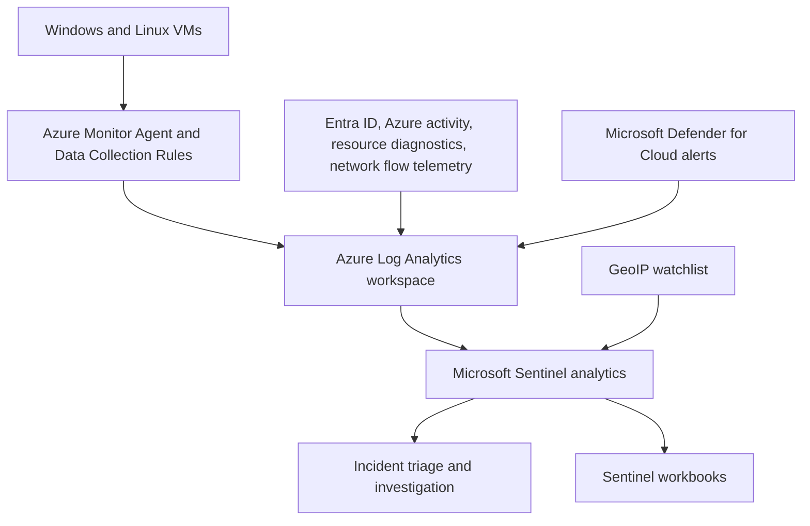

# BTH Cloud SOC

I built BTH Cloud SOC as an Azure security operations lab under **Beware The Hacker**. I wanted to follow the whole path from a failed login on a VM to a decision in Microsoft Sentinel. Can I find the event in the workspace, explain why the rule fired, and tell whether the alert calls for a response?

V1 is the Azure prototype I built and operated through the portal. I'm documenting it as a portfolio case study and using it as the foundation for a future commercial SOC product.

## How it works

| Layer | What I did in V1 |
| --- | --- |
| Endpoint collection | Configured Azure Monitor Agent and separate Data Collection Rules for Windows security events and Linux Syslog. I used KQL to check agent heartbeats and confirm records arrived in `SecurityEvent` and `Syslog`. |
| Cloud and network visibility | Set up diagnostic logging for Microsoft Entra ID, Azure Activity, Azure Storage, and Key Vault. I also worked with network security group (NSG) flow telemetry and integrated Microsoft Defender for Cloud alerts into the lab. |
| Detection and hunting | Configured Sentinel analytics rules, queried the underlying events in KQL, and used a GeoIP watchlist for IP enrichment. My lab tests included failed RDP and SSH logins. |
| Incident response | Reviewed incident timelines, entities, and supporting events in Sentinel. I used the NIST SP 800-61 Rev. 2 incident-handling lifecycle to structure the lab investigation and response exercise. |
| Reporting | Used Sentinel workbooks to visualize Windows RDP failures, Linux SSH failures, and inbound flows allowed by NSG rules. I captured screenshots before and after hardening the lab. |

## A Sentinel investigation I worked through

One Sentinel incident suggested a successful Windows brute-force attempt. I reviewed the rule, timeline, and entities, then queried Windows Security Event ID `4624` to see which accounts had logged in successfully. I narrowed the results by source IP and traced the activity back to a test I had run myself. I classified it as a false positive for a real compromise, then used the scenario to practice containment, including tightening the VM's inbound NSG rules.

My lab journal records work on 110 Sentinel incidents. That figure comes from my lab notes and is pending verification against an incident export.

## Explore the repository

I'm adding the V1 write-ups, KQL, and sanitized evidence during Phase 4. The paths below show where that material belongs as it's published.

| Path | What belongs there |
| --- | --- |
| `docs/architecture/` | Architecture diagrams and telemetry flow |
| `docs/implementation/` | V1 setup, configuration decisions, and troubleshooting |
| `docs/incident-response/` | Sentinel investigations and response walkthroughs |
| `docs/validation/` and `evidence/v1/` | Validation steps, observed results, and sanitized screenshots |
| `detections/` | KQL organized by Windows, Linux, identity, network, and Azure resources |
| `infrastructure/bicep/` | Bicep source for the repeatable Azure build |
| `roadmap/` | Project milestones and product direction |

See the [changelog](CHANGELOG.md) for the repository history.

## From lab to product

- **V1 · Manual Azure prototype.** The core Windows and Linux ingestion paths and Sentinel investigation workflow were exercised in the lab. End-to-end response automation and selected telemetry paths still need validation.
- **Phase 4 · Technical documentation.** I'm recording what I configured, how I checked it, and what the evidence supports.
- **V2 · Repeatable Azure deployment.** My next engineering milestone is a parameterized Bicep deployment for the workspace, Sentinel, and core telemetry. The goal is to deploy into a fresh lab and verify ingestion and detection using the same checks each time.
- **Product direction · Modular SOC for small SaaS teams.** I want teams to be able to deploy a core monitoring setup and add capabilities as they grow, especially teams preparing for SOC 2. Compliance evidence workflows and AI-assisted triage are future work.

The honeynet used intentionally exposed lab systems to observe attack traffic. The repository documents a lab prototype. Customer deployment remains a future milestone.

## Credits

I used Josh Madakor's Azure SIEM and honeypot lab as a starting point, including workbook templates and attack simulation resources. My implementation, troubleshooting, validation, and incident walkthroughs reflect the work I did in my own Azure environment. [Cyber Course V2](https://github.com/joshmadakor1/Cyber-Course-V2) · [Cyber Course](https://github.com/joshmadakor1/Cyber-Course)
